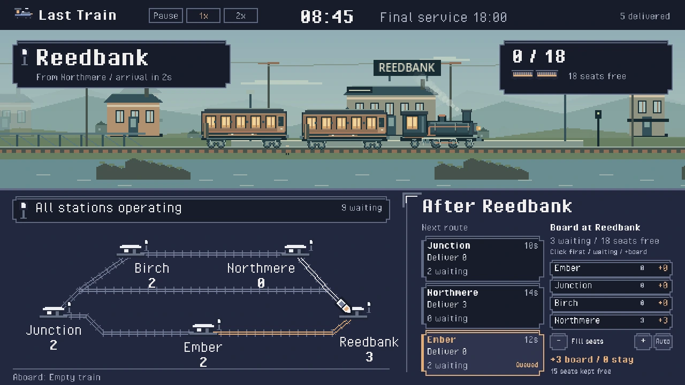
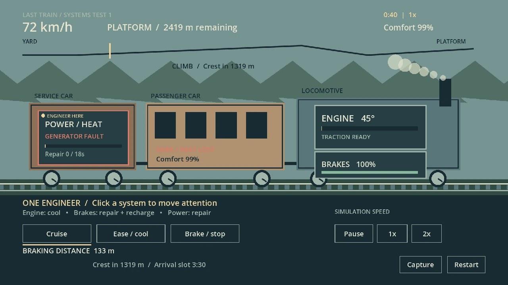
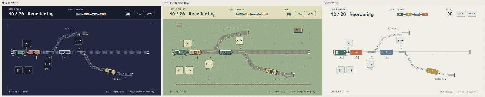
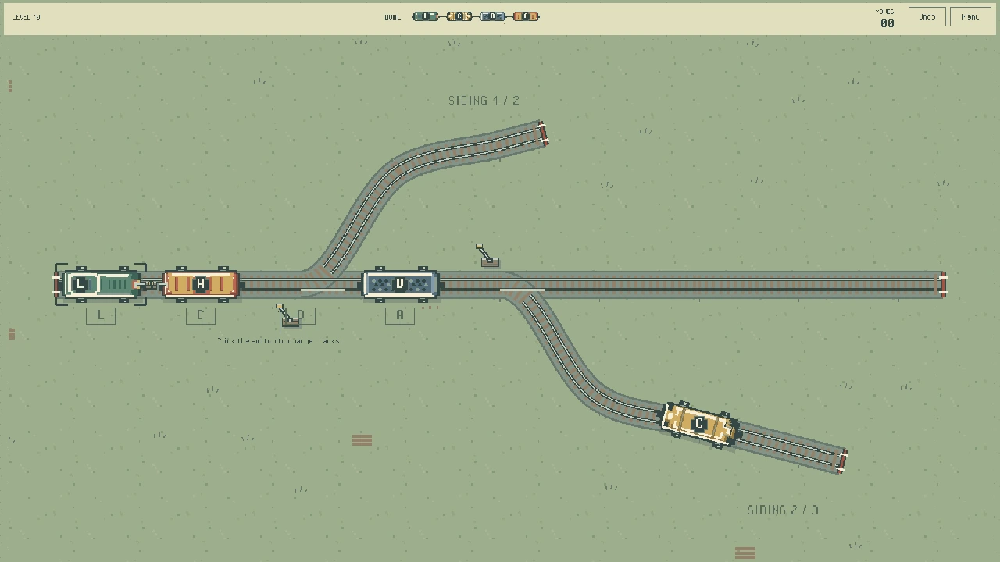
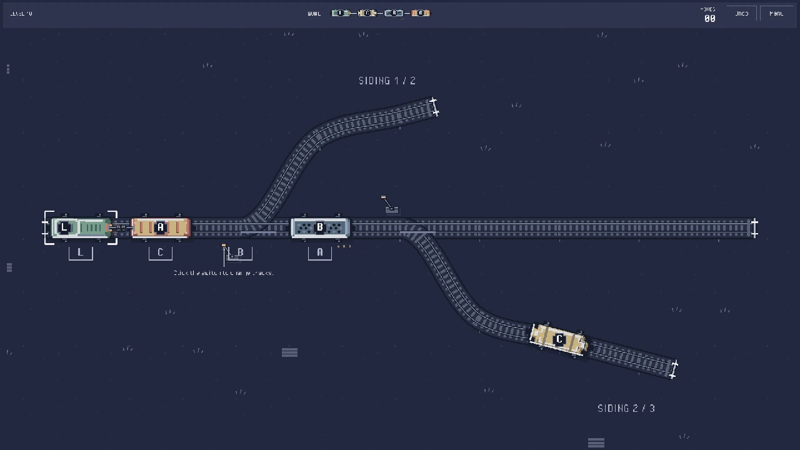
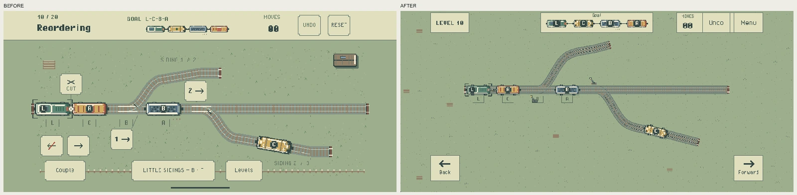

+++
title = "Three attempts at making a railway game"
description = "Three railway game prototypes in Godot, from watching trains to shunting wagons, and why I am leaving the last one unfinished."
author = "Igor Kulman"
date = "2026-11-11T07:00:00+02:00"
tags = ["Game Development", "Godot", "Indie", "iOS"]
keywords = ["Godot", "Game Development", "Railway", "Little Sidings", "Puzzle Games"]
url = "/three-attempts-at-making-a-railway-game"
+++

After making [Dungeon Pusher](/beating-appstore-review), a Sokoban-style puzzle game, and [Gravelo](https://gravelo.kulman.sk/), inspired by Teeter from the old Windows Mobile days, I wanted to try making something with trains. The previous two games were relatively simple, with individual levels and clear goals, and I liked the idea of building a small railway instead. There would be stations, passengers and a train to manage, although I did not have a very clear idea of what the player would actually do.

I called the project Last Train and started working on it with Godot 4 as game engine and Aseprite for the pixel art. I went through three quite different versions as I tried to find something I enjoyed playing. The last one is close enough to finished that I could probably release it with some more work, but I am not sure I want to.

## First attempt: A small railway simulation

My first idea was to have a train travel between stations, picking up passengers and taking them around a small railway network. I wanted to see it travelling through the countryside rather than just watch a dot move on a map, so I ended up with two views on the same screen. The upper part showed the train and its surroundings from the side, while the network map below showed the stations and connections.

<figure>
  
  <figcaption>Last Train, with the journey above and the railway network below.</figcaption>
</figure>

I was quite happy with how it looked, especially after experimenting with the interface and adding day and night environments. Watching the train stop at a station and then continue through the countryside was pleasant, and I spent a fair amount of time on that part.

<figure>
  <video data-animated-video controls muted loop playsinline preload="metadata" poster="live-rail-day-journey-poster.webp" width="1280" height="720" aria-label="Last Train daytime journey, including a station stop and departure">
    <source src="live-rail-day-journey.mp4" type="video/mp4">
    <a href="live-rail-day-journey.mp4">Watch the daytime journey.</a>
  </video>
  <figcaption>The train stopping at a station and continuing its journey.</figcaption>
</figure>

The problem was that playing it mostly meant watching it. The train moved, passengers got on and off, and everything worked more or less as intended, but there was very little for me to do. I tried changing the speed, adding interactions and presenting the information differently, hoping one of those changes would make it more interesting.

After a while I realized I could keep adding features without knowing what decisions the player was supposed to make. I liked watching the train, but once I had seen it travel around the network a few times, I had little reason to continue. I did not know how to fix that within the game I had built, so I tried a different approach.

## Second attempt: Managing the train itself

For the second version I took some inspiration from FTL: Faster Than Light and focused on keeping the train running. Instead of dealing with stations and passengers, the player would look after traction, braking, temperature and mechanical failures. I thought having to respond to problems and choose which system needed attention would give me something more interesting to do.

<figure>
  
  <figcaption>One engineer, three systems and a generator fault.</figcaption>
</figure>

I built the systems and controls around a single engineer who could only attend to one part of the train at a time. If something failed, I had to move the engineer away from whatever they were doing to deal with it. There were now gauges to watch and things to adjust, so at least I was doing more than waiting for the next station.

<figure>
  <video data-animated-video controls muted loop playsinline preload="metadata" poster="train-systems-power-response-poster.webp" width="1280" height="720" aria-label="A generator fault turns off the carriage lights and the engineer begins repairs">
    <source src="train-systems-power-response.mp4" type="video/mp4">
    <a href="train-systems-power-response.mp4">Watch the response to a generator fault.</a>
  </video>
  <figcaption>The lights go out and attention moves to the generator. Repairs are still in progress at the end.</figcaption>
</figure>

In practice, there was still a lot of waiting between problems. At normal speed I mostly watched the systems run and occasionally reacted to a failure. Speeding up the simulation helped with the waiting, but I did not enjoy it much more. I had assumed the first version was boring because there was not enough to do, and this one made me less sure that was the whole problem.

There were plenty of things I could have added, from more complicated failures to some kind of progression. But I was already spending time on systems I did not find very entertaining to manage, and I did not want to keep making them more complicated in the hope that they would eventually become fun.

## Third attempt: Railway shunting

For the third attempt I gave up on most of the simulation and made a small railway yard viewed from above. The goal was to use a locomotive to rearrange wagons into a specific order, moving them between sidings by operating switches and coupling or disconnecting them as needed. It was basically another Sokoban-like puzzle game, which was closer to something I already knew how to make.

<figure>
  <video data-animated-video controls muted loop playsinline preload="metadata" poster="shunting-schematic-rearrangement-poster.webp" width="1280" height="720" aria-label="A schematic railway puzzle showing a wagon left in a siding while another is retrieved and coupled">
    <source src="shunting-schematic-rearrangement.mp4" type="video/mp4">
    <a href="shunting-schematic-rearrangement.mp4">Watch the schematic shunting puzzle.</a>
  </video>
  <figcaption>One of the original puzzles, shown in a later preserved schematic version with a newer HUD.</figcaption>
</figure>

I started with five puzzles and actually enjoyed playing them. There was a reason to think about where to leave a wagon and which side to approach it from, and I could try out an idea immediately instead of waiting for something to happen. I remember getting stuck on one of the puzzles and trying several approaches before figuring it out. After the previous two versions, that was enough to make me think this one was worth continuing.

## Making it look like a game

The first version was fairly schematic, so once I was happy with the basic controls I started looking at how to make it look nicer. I tried several visual styles and liked two of them: a miniature railway on green grass and a darker version of the same yard. Rather than choose between them, I kept both as Day and Night themes.

<figure>
  
  <figcaption>The three mockups I used to compare styles: Night Yard, Little Sidings Day and a more abstract version.</figcaption>
</figure>

I added proper sprites for the locomotive and wagons, movement animations, coupling and uncoupling, switch levers and sound effects. By then I was calling it Little Sidings, and I was quite pleased with how it was coming together.

<figure>
  
  <figcaption>Little Sidings in Day.</figcaption>
</figure>

<figure>
  
  <figcaption>The same puzzle in Night.</figcaption>
</figure>

I wanted to play it on iPhone, iPad and macOS, which meant spending more time on the layout than I had expected. On the phone I went through versions with enormous controls and tiny trains, then versions where parts of the yard ended up underneath the interface or could not be reached. Meanwhile, making the desktop window larger could make the trains ridiculously large. It took several iterations to get the yard and controls to fit properly on all three platforms.

<figure>
  
  <figcaption>The earliest retained desktop phone preview on the left, and the revised interface in the iOS simulator on the right.</figcaption>
</figure>

With the layout sorted out, I also had Undo, Restart, level selection and saved progress working. There was still work I could do on the presentation, but it was already fairly close to what I would expect from a small game I downloaded from the App Store.

<figure>
  <video data-animated-video controls muted loop playsinline preload="metadata" poster="little-sidings-shunting-day-poster.webp" width="1280" height="720" aria-label="A complete Little Sidings puzzle solution using switches, temporary wagon storage, coupling and uncoupling">
    <source src="little-sidings-shunting-day.mp4" type="video/mp4">
    <a href="little-sidings-shunting-day.mp4">Watch a complete Little Sidings puzzle solution.</a>
  </video>
  <figcaption>A complete puzzle solution in the Day theme.</figcaption>
</figure>

## Adding more puzzles

I expanded the original five puzzles to twenty and verified that each one had a solution. When I sat down to play through them, though, I did not enjoy them nearly as much as the first few. Some were too easy, while others involved moving back and forth long after I had worked out what needed to happen. One introduced a loop with two switches that I found confusing rather than challenging, and another was more or less the previous puzzle with an extra wagon.

I stopped at Level 10 because I did not feel like playing any more. Given that I was making the game, that seemed like something I should probably address before spending more time on it.

My first thought was that I had introduced too much too early. The opening levels already used most of the interactions, leaving me to add more wagons and more complicated tracks to make later levels harder. I went back and changed the first few puzzles so that each introduced something specific: moving and coupling, using a switch, finding out that an occupied switch cannot change, and disconnecting wagons. I also split the confusing loop into simpler introductory puzzles and kept reworking the campaign until I had fifteen revised levels.

That helped with learning the controls and made the opening less confusing, but it did not really change how I felt about playing. After a few levels I was once again moving wagons back and forth without much interest in what came next. I could see that the revised puzzles were better, but I still did not want to play through all of them.

## Maybe I chose the wrong kind of game

I think I ended up making a puzzle game partly because it was practical. As a solo developer, a small set of rules and a collection of levels is much more manageable than something that needs characters, dialogue or a whole world. That was part of why Dungeon Pusher and Gravelo appealed to me as projects too, and after two unsuccessful attempts I was probably quite happy to return to something familiar.

The trouble is that I then need to come up with enough puzzles that are actually worth solving. Moving the locomotive is not very entertaining on its own, so most of the enjoyment depends on figuring out a solution. With the levels I had made, I kept seeing the same sequence of leaving a wagon in a siding, collecting another, moving back and reconnecting them. I do not know whether I had exhausted what I could do with the rules or just run out of good ideas for levels, but adding more wagons was not helping.

I did consider having the player restore an abandoned railway, with new stations opening as they completed puzzles. I quite liked that idea, and it would have given the levels some context. But I would still be asking people to spend most of their time solving the same puzzles I was already getting tired of. After the previous attempts, I was reluctant to spend more time building things around gameplay I did not enjoy.

## So what now?

I sent a macOS build to a few people to see what they thought, but nobody ended up trying it. I understand that people have their own things to do and testing my unfinished game is not much of a priority. It does mean I still do not know whether someone else would enjoy it more than I do, although I was not very motivated to keep asking by that point either.

There is probably not that much technical work left before I could release it. I could make more levels, improve the animations and put it on the App Store, or spend longer on the railway restoration idea. But I already have a Sokoban game there, and I am not sure why I would want to publish another one for an even narrower audience when I do not really want to play it myself.

With [the apps I build for myself](/why-i-still-build-ios-apps), I can at least say that I use them and they solve a problem I have, even if nobody else is interested. I do not have that reason to continue with Little Sidings. I enjoyed the first few puzzles and I like how it looks, but that is about as far as I got.

So for now I think I am going to leave it unfinished. It is disappointing after trying three different versions and getting the last one this close to release, but I would rather work on something else than spend more time on levels I do not feel like playing.

